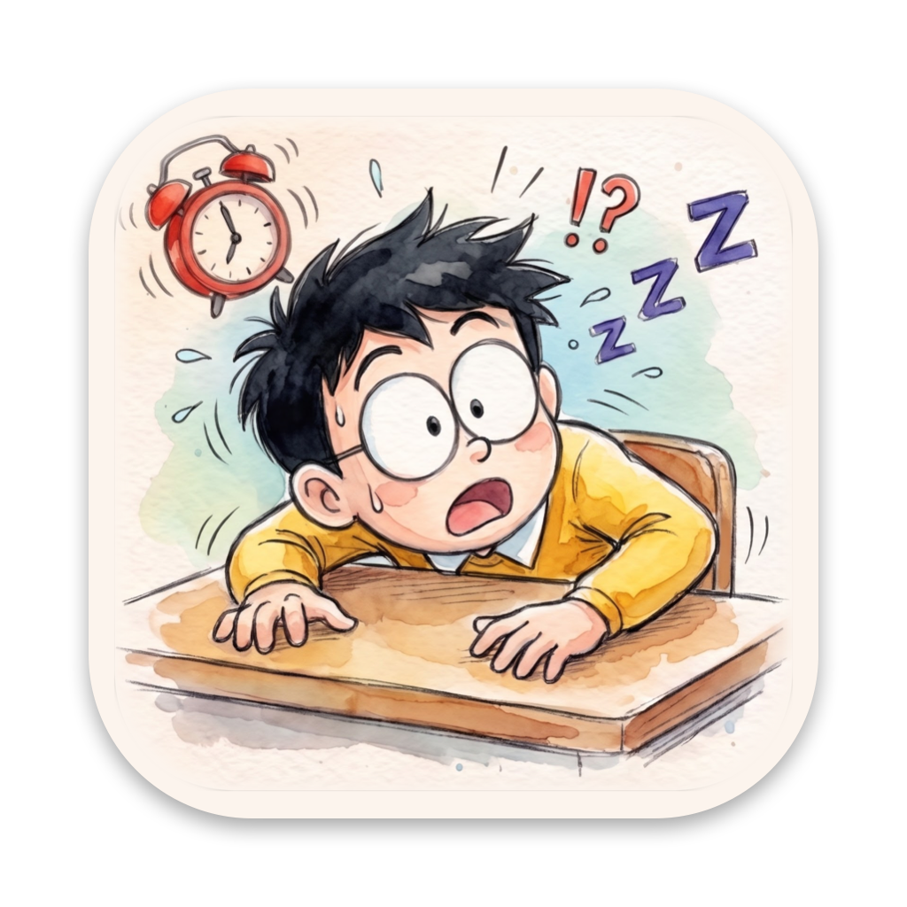
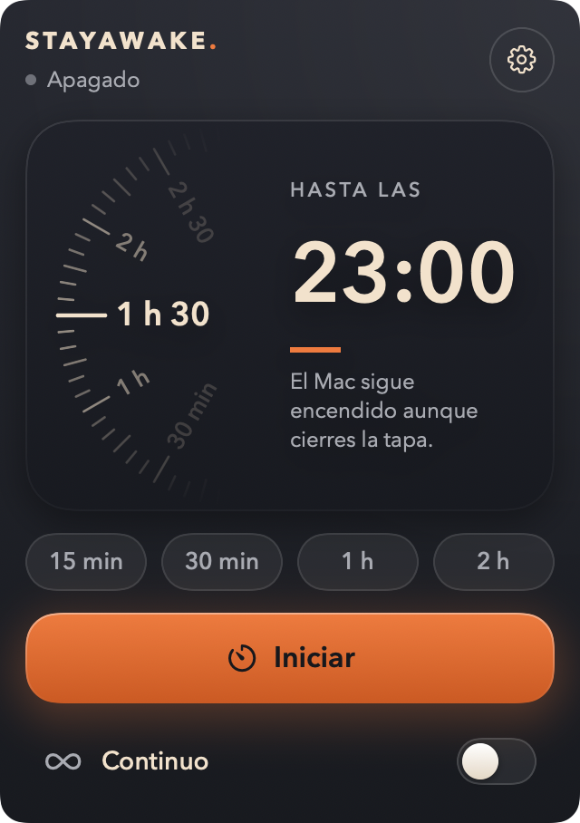
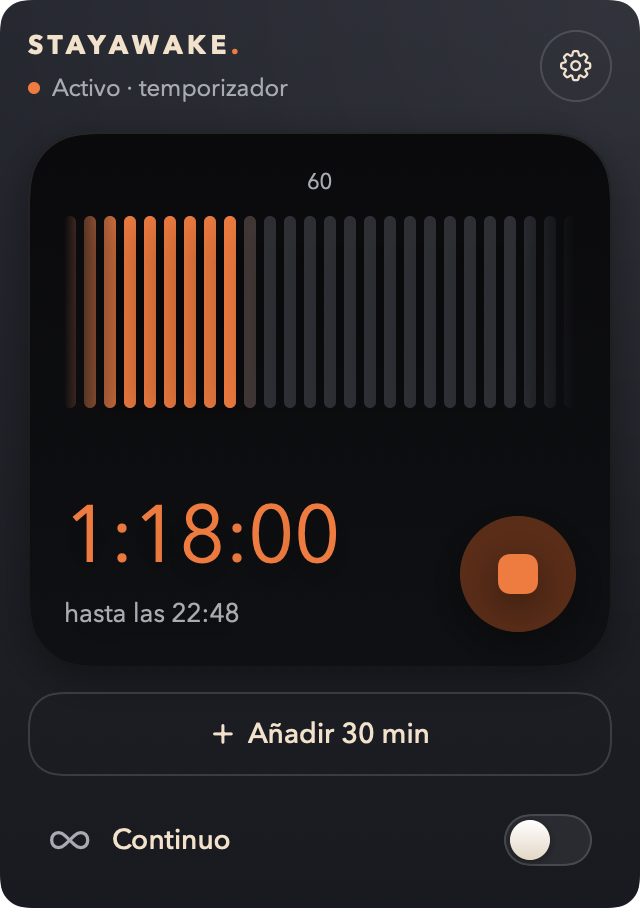
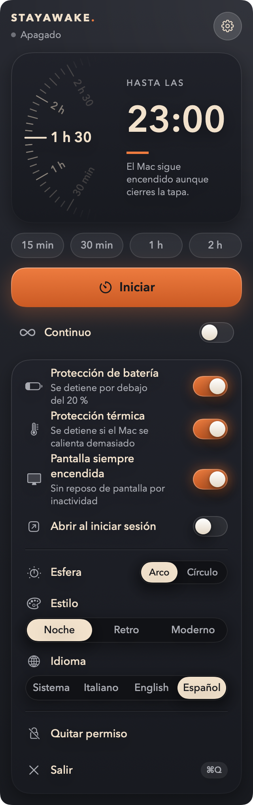
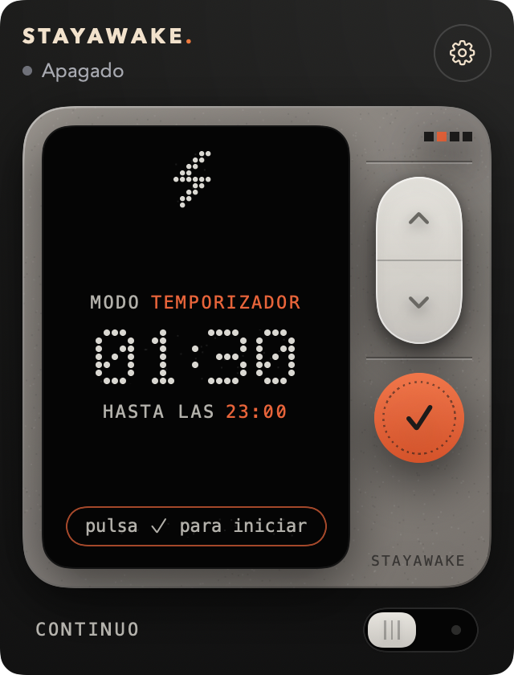
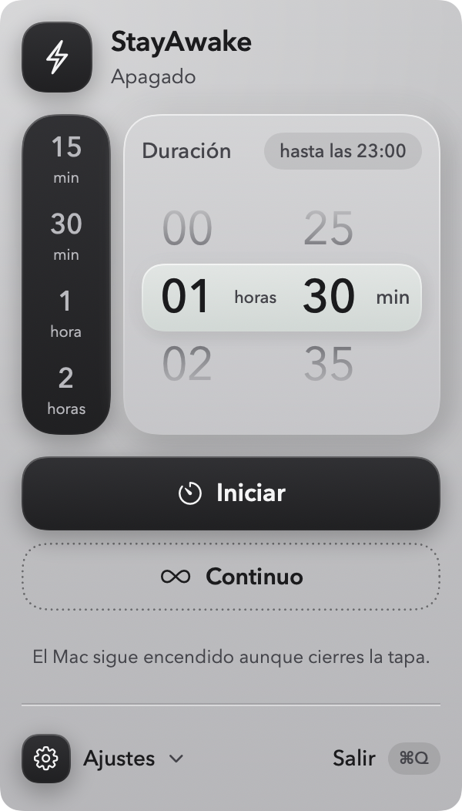
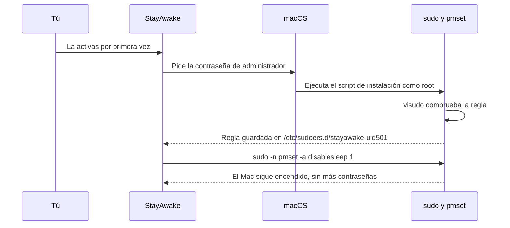
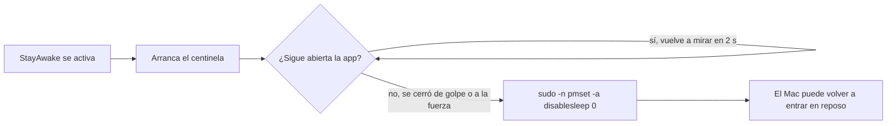

<p align="center"></p>

<h1 align="center">StayAwake</h1>

<p align="center"><b>Cierra la tapa. Sigue trabajando.</b><br>
Una pequeña app para la barra de menús de macOS que mantiene el Mac encendido, incluso con la tapa cerrada, durante el tiempo que elijas.</p>

<p align="center">
  <a href="https://github.com/ricky7x/StayAwake/releases/latest"></a>
  <a href="LICENSE"></a>
  
  <a href="https://github.com/ricky7x/StayAwake/actions/workflows/ci.yml"></a>
</p>

<p align="center"><a href="README.md">English</a> · <a href="README.it.md">Italiano</a> · <b>Español</b></p>

<p align="center"></p>

## Por qué

Empiezas un trabajo largo (un agente de IA rehaciendo tu código, una descarga grande, una compilación), cierras la tapa para ir a por un café… y macOS pone el Mac en reposo. Todo se detiene.

StayAwake mantiene el Mac encendido con la tapa cerrada, exactamente el tiempo que elijas, y luego lo deja todo como estaba. Es gratuita, de código abierto y no hace ninguna conexión de red.

## Funciones

### Elige un tiempo, o déjalo encendido



- Gira la esfera (rueda, arrastre o clic) de **5 minutos a 24 horas**, o elige un tiempo rápido: 15 min, 30 min, 1 h, 2 h.
- La tarjeta muestra **hasta qué hora** sigue encendido, en el formato de 12 o 24 horas de tu Mac.
- **Continuo** mantiene el Mac encendido hasta que lo detengas.
- Funciona **con la tapa cerrada**: usa `pmset disablesleep` de macOS.

<br clear="right">

### Temporizador en marcha



- Una gran cuenta atrás y una barra que se llena con el paso del tiempo.
- **Añadir 30 min** sin detenerlo.
- Cuando se acaba el tiempo, el Mac vuelve a la normalidad, incluso con la tapa todavía cerrada.
- La barra de menús muestra el tiempo que queda. En los estilos Noche y Retro el icono se convierte en una píldora con un anillo que se llena:


<br clear="right">

### La seguridad, primero



- **Protección de batería:** con batería, se detiene por debajo del 20&nbsp;%.
- **Protección térmica:** se detiene si macOS indica una temperatura crítica.
- **A prueba de cierres inesperados:** si la app se cierra de golpe o se fuerza su salida, un pequeño proceso en segundo plano devuelve el reposo a la normalidad en un par de segundos.
- Al salir, siempre devuelve el reposo a la normalidad.
- **Pantalla siempre encendida**, **Abrir al iniciar sesión** y **Quitar permiso** están en Ajustes (quitarlo pide la contraseña de administrador).

<br clear="right">

### Tres estilos, tres idiomas

<table>
  <tr>
    <td align="center"><br><b>Noche</b></td>
    <td align="center"><br><b>Retro</b></td>
    <td align="center"><br><b>Moderno</b></td>
  </tr>
</table>

**Ajustes → Idioma**: Sistema, Italiano, English, Español. *Sistema* sigue el idioma de macOS, o el inglés si no es ninguno de estos. El cambio es inmediato.

<!-- ## Mira el anuncio (video): si attiva dopo la prima release, quando lo spot è allegato -->

## Cómo funciona

La primera vez que activas StayAwake, macOS pide una vez la contraseña de administrador. A partir de ahí, StayAwake puede activar y desactivar el reposo por sí sola, y solo eso:



Mientras está activa, un pequeño proceso centinela vigila la app. Si la app desaparece, el reposo vuelve:



## Requisitos

macOS 14 Sonoma o posterior, en Mac con Apple silicon o Intel.

## Instalación

1. Descarga `StayAwake.zip` y `StayAwake.zip.sha256` de la [última versión](https://github.com/ricky7x/StayAwake/releases/latest).
2. Comprueba la descarga (opcional, recomendado):

   ```bash
   shasum -a 256 -c StayAwake.zip.sha256
   gh attestation verify StayAwake.zip -R ricky7x/StayAwake
   ```

   - El primer comando comprueba que la descarga no esté dañada. El hash viene de la misma versión, así que por sí solo no demuestra de dónde viene el archivo.
   - El segundo ([GitHub CLI](https://cli.github.com)) demuestra que el zip lo creó GitHub Actions **a partir del código público de este repositorio**.
3. Descomprímelo y mueve **StayAwake** a la carpeta **Aplicaciones**.
4. Ábrela. StayAwake es gratuita y no está notarizada por Apple, así que la primera vez macOS dice que no puede verificar al desarrollador.
   - Pulsa **OK**, luego abre **Ajustes del Sistema → Privacidad y seguridad**.
   - Baja hasta el mensaje sobre StayAwake y pulsa **Abrir igualmente**. Solo hace falta una vez.
   - No desactives Gatekeeper ni quites los atributos de cuarentena para evitar el aviso.

Busca el rayo ⚡ en la barra de menús.

## Compilarla tú mismo

Necesitas Xcode (la app completa: las macros de SwiftUI no se compilan solo con las Command Line Tools).

```bash
git clone https://github.com/ricky7x/StayAwake.git
cd StayAwake
./test.sh        # pruebas, sin contraseña de administrador
./install.sh     # compila e instala en ~/Aplicaciones
```

`./release.sh` genera el mismo zip universal con firma ad-hoc que usan las versiones publicadas. El anuncio y las imágenes de esta página salen de la app real: mira `promo/`.

## Para qué sirve la contraseña

Solo un administrador puede cambiar `disablesleep`. La primera vez que activas StayAwake, macOS muestra su propia ventana de contraseña: StayAwake no la ve ni la guarda. Con ella, StayAwake instala una regla que permite **solo a tu usuario** ejecutar **solo estos dos comandos** sin contraseña:

```
#501 ALL=(root) NOPASSWD: /usr/bin/pmset -a disablesleep 0, /usr/bin/pmset -a disablesleep 1
```

- `501` es tu ID de usuario.
- La regla se comprueba con `visudo` antes de instalarla.
- Está en su propio archivo, `/etc/sudoers.d/stayawake-uid<tu ID>`, uno por usuario, así los usuarios del mismo Mac no se sobrescriben entre sí.

Para verla:

```bash
sudo cat /etc/sudoers.d/stayawake-uid$(id -u)
```

Conviene saberlo: otras apps que se ejecutan con tu usuario también pueden usar esta regla, pero solo para activar o desactivar el reposo, nada más.

## Quitarlo todo

1. **Primero apaga StayAwake** (Detener, o desactiva Continuo).
2. En StayAwake: **Ajustes → Quitar permiso** (macOS pide la contraseña de administrador). O en Terminal:

   ```bash
   sudo rm /etc/sudoers.d/stayawake-uid$(id -u)
   sudo pmset -a disablesleep 0    # se asegura de que el reposo vuelva a estar activo
   ```

3. Sal de StayAwake y arrástrala a la Papelera.

Las primeras versiones usaban un solo archivo, `/etc/sudoers.d/stayawake`. StayAwake lo quita sola la primera vez que la activas, si contiene tu regla antigua; si no, puedes borrarlo con `sudo rm /etc/sudoers.d/stayawake`.

## Seguridad y límites

- **No metas el Mac en una mochila con StayAwake activo.** Con la tapa cerrada puede calentarse. La protección térmica detiene StayAwake a temperatura crítica, pero no confíes solo en ella.
- Con batería, el Mac sigue consumiendo con la tapa cerrada. La protección de batería detiene StayAwake por debajo del 20&nbsp;%.
- Si el Mac **se reinicia** con StayAwake activo, el reposo sigue desactivado hasta que StayAwake vuelva a abrirse, también en la pantalla de inicio de sesión. Activa **Abrir al iniciar sesión** para que el reposo vuelva en cuanto entres.
- El reposo es un ajuste de todo el Mac. Si varias personas usan StayAwake en el mismo Mac (cambio rápido de usuario), abrirla o cerrarla en una cuenta reactiva el reposo para todos, aunque otra cuenta la siga mostrando activa.
- StayAwake no hace ninguna conexión de red.

## Preguntas frecuentes

**¿Funciona con la tapa cerrada y con batería?** Sí. La protección de batería la detiene por debajo del 20&nbsp;%, y puedes desactivarla en Ajustes.

**¿Necesita conexión a internet?** No. StayAwake nunca se conecta a la red.

**¿Qué pasa si se cierra de golpe?** Un pequeño proceso en segundo plano lo nota en un par de segundos y vuelve a activar el reposo.

**¿Funciona en Mac con Intel?** Sí. La versión es universal (Apple silicon e Intel) y necesita macOS 14 o posterior.

**¿Puedo ver exactamente qué se ejecuta como administrador?** Sí: lee [SECURITY.md](SECURITY.md) y [`Sources/Permission.swift`](Sources/Permission.swift).

## Seguridad

En [SECURITY.md](SECURITY.md) se explica qué se ejecuta como administrador y cómo informar de una vulnerabilidad.

## Licencia

[MIT](LICENSE) © 2026 Riccardo Gnoni
