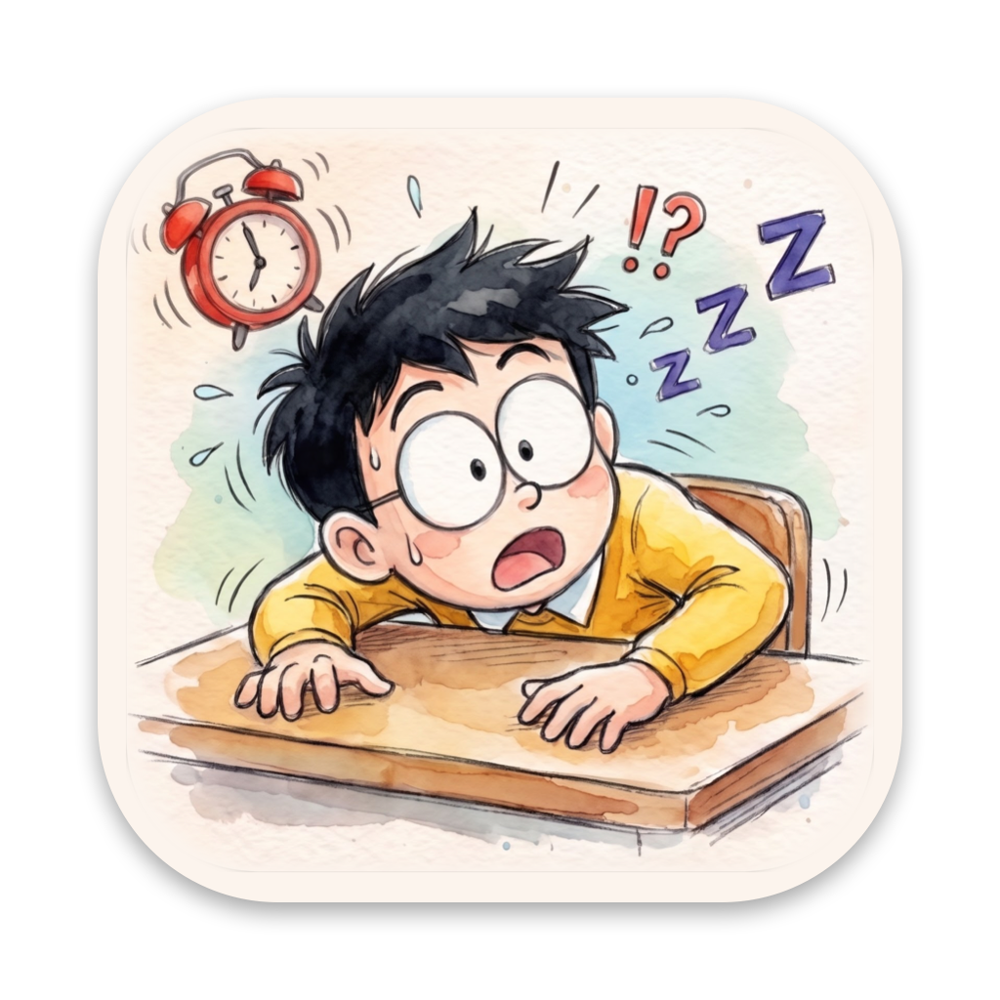
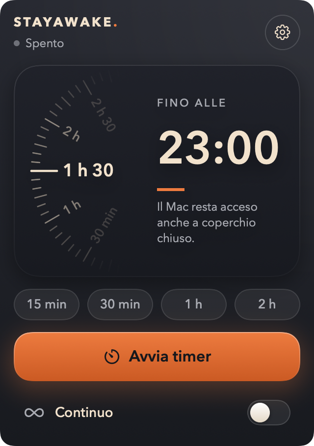
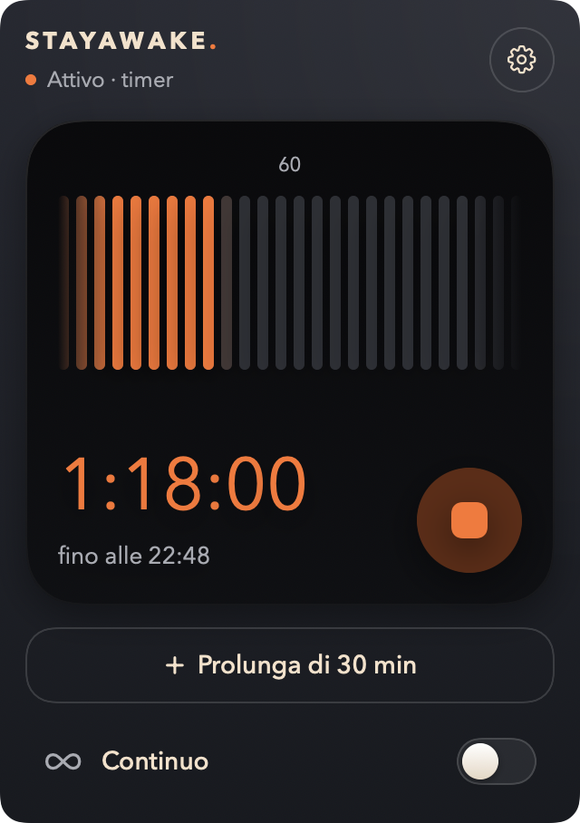
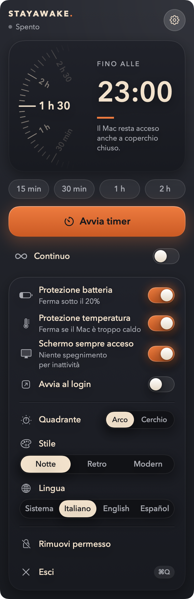
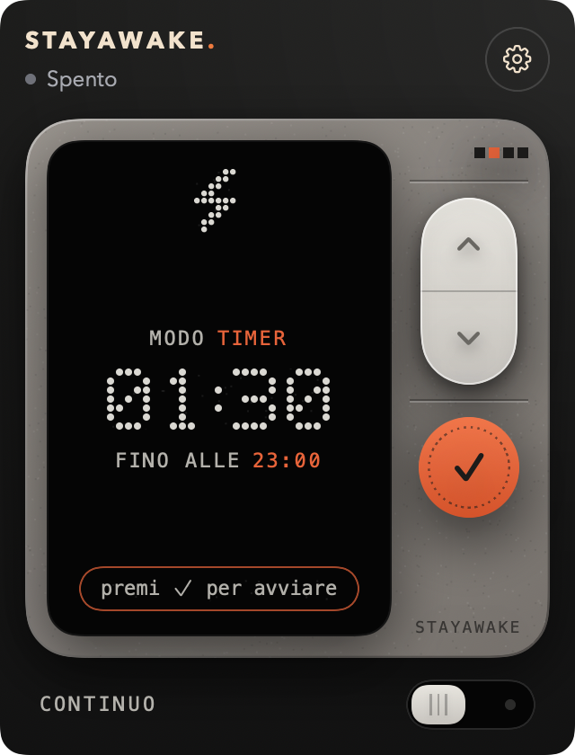
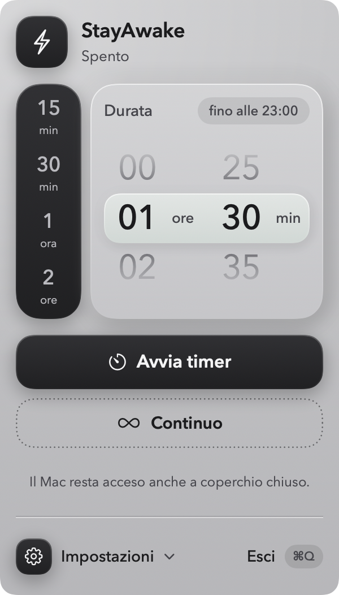
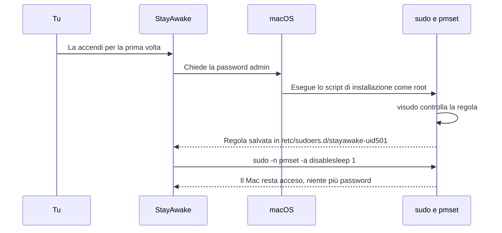
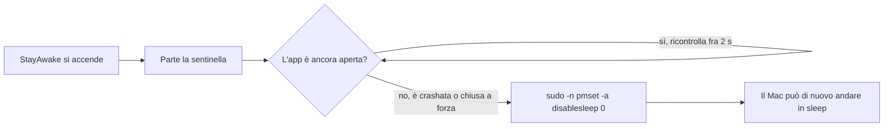

<p align="center"></p>

<h1 align="center">StayAwake</h1>

<p align="center"><b>Chiudi il coperchio. Continua a lavorare.</b><br>
Una piccola app per la barra dei menu di macOS che tiene il Mac acceso, anche a coperchio chiuso, per tutto il tempo che scegli.</p>

<p align="center">
  <a href="https://github.com/ricky7x/StayAwake/releases/latest"></a>
  <a href="LICENSE"></a>
  
  <a href="https://github.com/ricky7x/StayAwake/actions/workflows/ci.yml"></a>
</p>

<p align="center"><a href="README.md">English</a> · <b>Italiano</b> · <a href="README.es.md">Español</a></p>

<p align="center"></p>

## Perché

Avvii un lavoro lungo (un agente AI che rifà il tuo codice, un download grosso, una build), chiudi il coperchio per un caffè… e macOS mette il Mac in sleep. Si ferma tutto.

StayAwake tiene il Mac acceso a coperchio chiuso, esattamente per il tempo che scegli, poi rimette tutto com'era. È gratuita, open source e non fa nessuna connessione di rete.

## Funzioni

### Scegli quanto tempo, o lascialo acceso



- Gira il quadrante (rotella, trascinamento o clic) da **5 minuti a 24 ore**, oppure scegli un tempo rapido: 15 min, 30 min, 1 h, 2 h.
- La scheda mostra **fino a che ora** resta acceso, nel formato a 12 o 24 ore del tuo Mac.
- **Continuo** tiene il Mac acceso finché non lo fermi.
- Funziona **a coperchio chiuso**: usa `pmset disablesleep` di macOS.

<br clear="right">

### Timer in corso



- Un grande conto alla rovescia e una barra che si riempie col passare del tempo.
- **Prolunga di 30 min** senza fermarti.
- Quando il tempo finisce, il Mac torna normale, anche col coperchio ancora chiuso.
- La barra dei menu mostra il tempo che resta. Negli stili Notte e Retro l'icona diventa una pillola con un anello che si riempie:


<br clear="right">

### Prima la sicurezza



- **Protezione batteria:** a batteria, si ferma sotto il 20%.
- **Protezione temperatura:** si ferma se macOS segnala una temperatura critica.
- **A prova di crash:** se l'app crasha o viene chiusa a forza, un piccolo processo in background riporta lo sleep alla normalità entro un paio di secondi.
- Quando esci, riporta sempre lo sleep alla normalità.
- **Schermo sempre acceso**, **Avvia al login** e **Rimuovi permesso** sono nelle Impostazioni (la rimozione chiede la password admin).

<br clear="right">

### Tre stili, tre lingue

<table>
  <tr>
    <td align="center"><br><b>Notte</b></td>
    <td align="center"><br><b>Retro</b></td>
    <td align="center"><br><b>Modern</b></td>
  </tr>
</table>

**Impostazioni → Lingua**: Sistema, Italiano, English, Español. *Sistema* segue la lingua di macOS, oppure l'inglese se non è nessuna di queste. Il cambio è immediato.

<!-- ## Guarda lo spot (video): si attiva dopo la prima release, quando lo spot è allegato -->

## Come funziona

La prima volta che accendi StayAwake, macOS chiede una volta la password di amministratore. Da lì in poi StayAwake può accendere e spegnere lo sleep da sola, e solo quello:



Mentre è accesa, un piccolo processo sentinella controlla l'app. Se l'app sparisce, lo sleep torna:



## Requisiti

macOS 14 Sonoma o successivo, su Mac con Apple silicon o Intel.

## Installazione

1. Scarica `StayAwake.zip` e `StayAwake.zip.sha256` dall'[ultima release](https://github.com/ricky7x/StayAwake/releases/latest).
2. Verifica il download (facoltativo, consigliato):

   ```bash
   shasum -a 256 -c StayAwake.zip.sha256
   gh attestation verify StayAwake.zip -R ricky7x/StayAwake
   ```

   - Il primo comando controlla che il download non sia rovinato. L'hash viene dalla stessa release, quindi da solo non dimostra da dove arriva il file.
   - Il secondo ([GitHub CLI](https://cli.github.com)) dimostra che lo zip è stato costruito da GitHub Actions **a partire dal codice pubblico di questo repository**.
3. Decomprimi e sposta **StayAwake** nella cartella **Applicazioni**.
4. Aprila. StayAwake è gratuita e non è notarizzata da Apple, quindi la prima volta macOS dice che non può verificare lo sviluppatore.
   - Premi **Fine**, poi apri **Impostazioni di Sistema → Privacy e sicurezza**.
   - Scorri fino al messaggio su StayAwake e premi **Apri comunque**. Basta farlo una volta.
   - Non disattivare Gatekeeper e non togliere gli attributi di quarantena per aggirare l'avviso.

Cerca il fulmine ⚡ nella barra dei menu.

## Compilarla da sé

Serve Xcode (l'app completa: le macro di SwiftUI non si compilano con i soli Command Line Tools).

```bash
git clone https://github.com/ricky7x/StayAwake.git
cd StayAwake
./test.sh        # test, senza password admin
./install.sh     # compila e installa in ~/Applicazioni
```

`./release.sh` produce lo stesso zip universale firmato ad-hoc delle release. Lo spot e le immagini di questa pagina sono fatti dall'app vera: vedi `promo/`.

## A cosa serve la password

Solo un amministratore può cambiare `disablesleep`. La prima volta che accendi StayAwake, macOS mostra la sua finestra della password: StayAwake non la vede e non la salva. Con quella password StayAwake installa una regola che permette **solo al tuo utente** di eseguire **solo questi due comandi** senza password:

```
#501 ALL=(root) NOPASSWD: /usr/bin/pmset -a disablesleep 0, /usr/bin/pmset -a disablesleep 1
```

- `501` è il tuo ID utente.
- La regola viene controllata con `visudo` prima di essere installata.
- Sta in un file suo, `/etc/sudoers.d/stayawake-uid<tuo ID>`, uno per utente, così gli utenti dello stesso Mac non si sovrascrivono a vicenda.

Per vederla:

```bash
sudo cat /etc/sudoers.d/stayawake-uid$(id -u)
```

Da sapere: anche le altre app che girano con il tuo utente possono usare questa regola, ma solo per accendere o spegnere lo sleep, nient'altro.

## Togliere tutto

1. **Prima spegni StayAwake** (Stop, oppure disattiva Continuo).
2. In StayAwake: **Impostazioni → Rimuovi permesso** (macOS chiede la password admin). Oppure nel Terminale:

   ```bash
   sudo rm /etc/sudoers.d/stayawake-uid$(id -u)
   sudo pmset -a disablesleep 0    # si assicura che lo sleep sia tornato normale
   ```

3. Esci da StayAwake e trascinala nel Cestino.

Le prime versioni usavano un solo file, `/etc/sudoers.d/stayawake`. StayAwake lo toglie da sola la prima volta che la accendi, se contiene la tua vecchia regola; altrimenti puoi cancellarlo con `sudo rm /etc/sudoers.d/stayawake`.

## Sicurezza e limiti

- **Non mettere il Mac in uno zaino con StayAwake attivo.** A coperchio chiuso può scaldarsi. La protezione temperatura ferma StayAwake a temperatura critica, ma non affidarti solo a quella.
- A batteria, a coperchio chiuso il Mac continua a consumare. La protezione batteria ferma StayAwake sotto il 20%.
- Se il Mac **si riavvia** con StayAwake attivo, lo sleep resta disattivato finché StayAwake non si riapre, anche alla schermata di login. Attiva **Avvia al login**, così lo sleep torna normale appena entri.
- Lo sleep è un'impostazione di tutto il Mac. Se più persone usano StayAwake sullo stesso Mac (cambio rapido utente), aprirla o chiuderla in un account riattiva lo sleep per tutti, anche se un altro account la mostra ancora accesa.
- StayAwake non fa nessuna connessione di rete.

## Domande frequenti

**Funziona a coperchio chiuso anche a batteria?** Sì. La protezione batteria la ferma sotto il 20%, e puoi disattivarla nelle Impostazioni.

**Serve una connessione a internet?** No. StayAwake non si collega mai alla rete.

**Cosa succede se crasha?** Un piccolo processo in background se ne accorge entro un paio di secondi e riattiva lo sleep.

**Funziona sui Mac Intel?** Sì. La release è universale (Apple silicon e Intel) e richiede macOS 14 o successivo.

**Posso vedere esattamente cosa gira come amministratore?** Sì: leggi [SECURITY.md](SECURITY.md) e [`Sources/Permission.swift`](Sources/Permission.swift).

## Sicurezza

In [SECURITY.md](SECURITY.md) trovi cosa gira come amministratore e come segnalare una vulnerabilità.

## Licenza

[MIT](LICENSE) © 2026 Riccardo Gnoni
