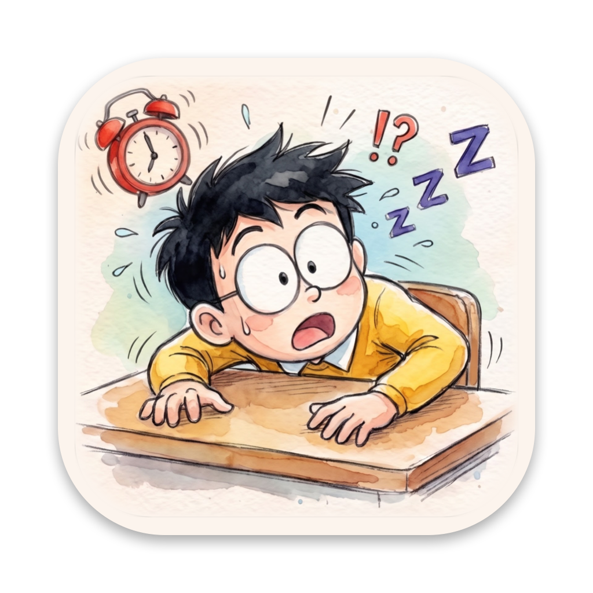
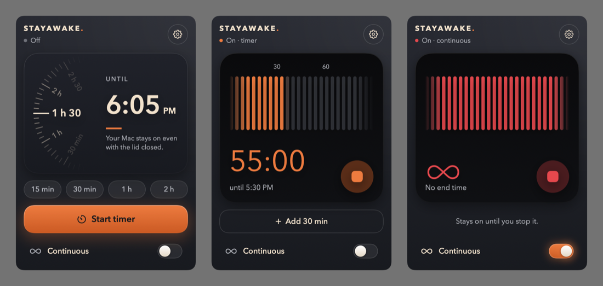
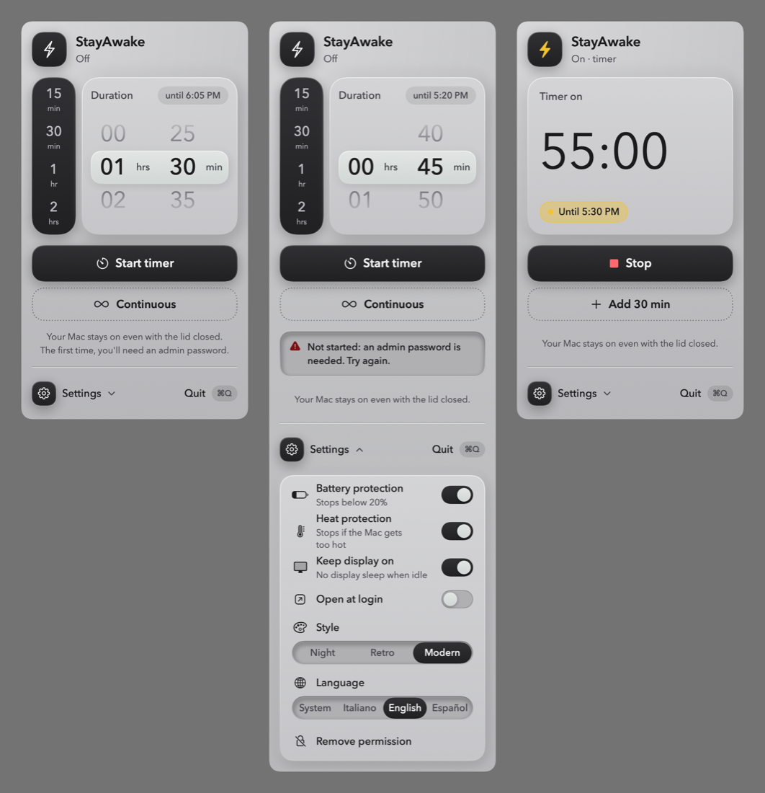
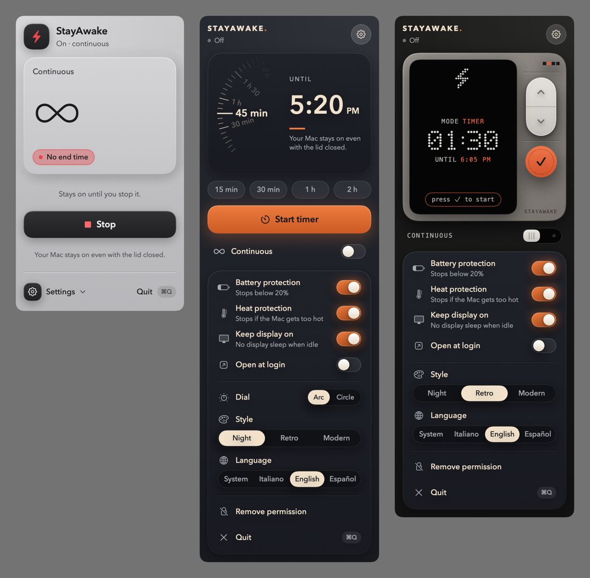

<p align="center"></p>

# StayAwake

**English** · [Italiano](README.it.md) · [Español](README.es.md)

A small macOS menu bar app that keeps your Mac awake, **even with the lid closed**, for as long as you choose.

<p align="center"></p>

## What it does

- **Timer** from 5 minutes to 24 hours, or **continuous** until you stop it. You can add time while it runs.
- Works **with the lid closed** (it uses macOS's `pmset disablesleep`).
- **Safety first:**
  - stops when the battery drops below 20% (optional);
  - stops if macOS reports a critical temperature (optional);
  - restores normal sleep when you quit, and even if the app crashes or is force-quit.
- Three styles (Night, Retro, Modern) and three languages (English, Italiano, Español).
- **No network access**, no telemetry, no automatic updates.

<p align="center"></p>

## Requirements

macOS 14 Sonoma or later, on Apple silicon or Intel.

## Install

1. Download `StayAwake.zip` and `StayAwake.zip.sha256` from the [latest release](https://github.com/ricky7x/StayAwake/releases/latest).
2. Check the download (optional, recommended):

   ```bash
   shasum -a 256 -c StayAwake.zip.sha256
   gh attestation verify StayAwake.zip -R ricky7x/StayAwake
   ```

   - The first command checks that the file wasn't damaged or altered.
   - The second ([GitHub CLI](https://cli.github.com)) proves that the zip was built by GitHub Actions **from this repository's public source code**.
3. Unzip it and move **StayAwake** to your **Applications** folder.
4. Open it. StayAwake is free and not notarized by Apple, so the first time macOS says it can't verify the developer.
   - Click **Done**, then open **System Settings → Privacy & Security**.
   - Scroll down to the message about StayAwake and click **Open Anyway**. You only need to do this once.
   - Please don't disable Gatekeeper or strip quarantine attributes to get around this.

Look for the bolt ⚡ in the menu bar.

## Build it yourself

You need Xcode (the full app: SwiftUI macros don't build with the Command Line Tools alone).

```bash
git clone https://github.com/ricky7x/StayAwake.git
cd StayAwake
./test.sh        # tests, no admin password needed
./installa.sh    # builds and installs to ~/Applications ("installa" is Italian for "install")
```

`./release.sh` builds the same universal, ad-hoc signed zip that the releases use.

## What the password is for

Only an administrator can change `disablesleep`. The first time you start StayAwake, macOS shows its own password dialog: StayAwake never sees or stores your password. With it, StayAwake installs a rule that lets **only your user** run **only these two commands** without a password:

```
#501 ALL=(root) NOPASSWD: /usr/bin/pmset -a disablesleep 0, /usr/bin/pmset -a disablesleep 1
```

- `501` is your user ID.
- The rule is checked with `visudo` before it's installed.
- It lives in its own file, `/etc/sudoers.d/stayawake-uid<your ID>`, one per user, so users on the same Mac don't overwrite each other.

To see it:

```bash
sudo cat /etc/sudoers.d/stayawake-uid$(id -u)
```

Good to know: any app running as your user could also use this rule, but only to turn sleep on or off, nothing else.

## Remove everything

1. **Turn StayAwake off first** (Stop, or switch off Continuous).
2. In StayAwake: **Settings → Remove permission** (macOS asks for the admin password). Or in Terminal:

   ```bash
   sudo rm /etc/sudoers.d/stayawake-uid$(id -u)
   sudo pmset -a disablesleep 0    # makes sure sleep is back on
   ```

3. Quit StayAwake and drag it to the Trash.

Versions before 1.0 used a single file, `/etc/sudoers.d/stayawake`. Version 1.0 removes it automatically if it contains your old rule; otherwise you can delete it with `sudo rm /etc/sudoers.d/stayawake`.

## Safety and limits

- **Don't put your Mac in a bag while StayAwake is on.** With the lid closed it can get hot. Heat protection stops StayAwake at a critical temperature, but don't rely on it alone.
- On battery, the Mac keeps using power with the lid closed. Battery protection stops StayAwake below 20%.
- If the Mac **restarts** while StayAwake is on, sleep stays disabled until StayAwake opens again. Turn on **Open at login** so that happens by itself.
- If StayAwake crashes or is force-quit, a tiny background process restores normal sleep within a couple of seconds.
- StayAwake makes no network connections.

## Languages

**Settings → Language**: System, Italiano, English, Español. *System* follows your macOS language, or English if it's none of these.

<p align="center"></p>

## Security

Read [SECURITY.md](SECURITY.md) to see what runs as administrator and how to report a vulnerability.

## License

[MIT](LICENSE) © 2026 Riccardo Gnoni
