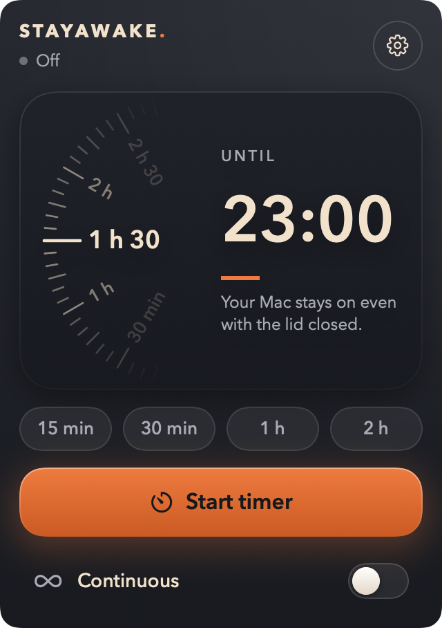
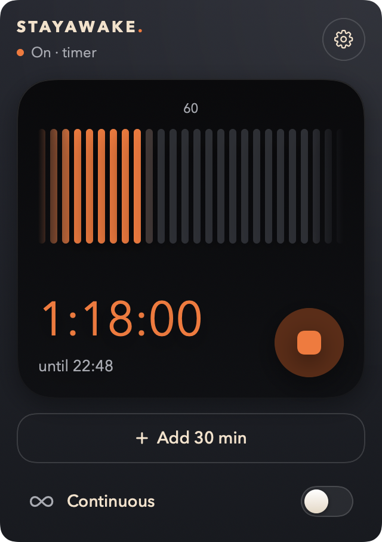
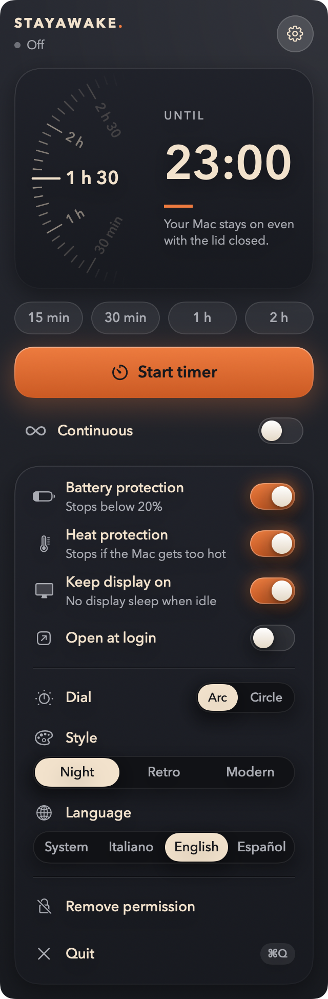
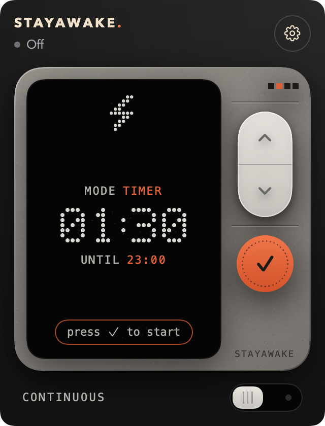
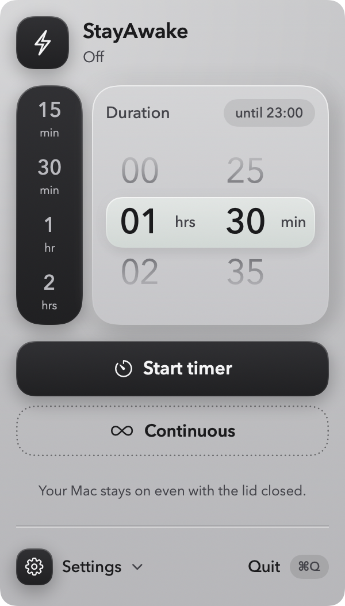
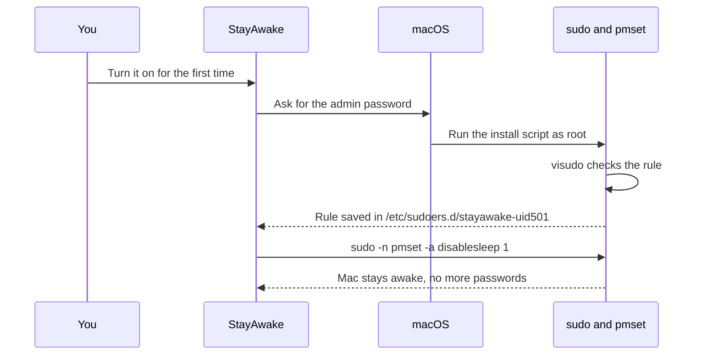
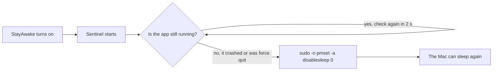

<p align="center"></p>

<h1 align="center">StayAwake</h1>

<p align="center"><b>Close the lid. Keep working.</b><br>
A small macOS menu bar app that keeps your Mac awake, even with the lid closed, for as long as you choose.</p>

<p align="center">
  <a href="https://github.com/ricky7x/StayAwake/releases/latest"></a>
  <a href="LICENSE"></a>
  
  <a href="https://github.com/ricky7x/StayAwake/actions/workflows/ci.yml"></a>
</p>

<p align="center"><b>English</b> · <a href="README.it.md">Italiano</a> · <a href="README.es.md">Español</a></p>

<p align="center"></p>

## Why

You start a long job (an AI agent refactoring your code, a big download, a build), you close the lid to grab a coffee… and macOS puts the Mac to sleep. Everything stops.

StayAwake keeps the Mac awake with the lid closed, for exactly as long as you choose, and then puts things back the way they were. It's free, open source and makes no network connections.

## Features

### Pick a time, or keep it on



- Turn the dial (scroll, drag or click) from **5 minutes to 24 hours**, or tap a preset: 15 min, 30 min, 1 h, 2 h.
- The card shows **when it will end**, in your Mac's 12 or 24-hour format.
- **Continuous** keeps the Mac awake until you stop it.
- Works **with the lid closed**: it uses macOS's own `pmset disablesleep`.

<br clear="right">

### Timer running



- A big countdown and a bar that fills as time passes.
- **Add 30 min** without stopping.
- When the time is up, the Mac goes back to normal, even with the lid still closed.
- The menu bar shows the time left. In the Night and Retro styles the icon becomes a pill with a ring that fills up:


<br clear="right">

### Safety first



- **Battery protection:** on battery, it stops below 20%.
- **Heat protection:** it stops if macOS reports a critical temperature.
- **Crash-proof:** if the app crashes or is force-quit, a tiny background process restores normal sleep within a couple of seconds.
- It always restores normal sleep when you quit.
- **Keep display on**, **Open at login**, and **Remove permission** in one click.

<br clear="right">

### Three styles, three languages

<table>
  <tr>
    <td align="center"><br><b>Night</b></td>
    <td align="center"><br><b>Retro</b></td>
    <td align="center"><br><b>Modern</b></td>
  </tr>
</table>

**Settings → Language**: System, Italiano, English, Español. *System* follows your macOS language, or English if it's none of these. The change is immediate.

## Watch the spot

<!-- video: the 40-second spot is attached here after the first release -->

## How it works

The first time you turn StayAwake on, macOS asks for an administrator password once. From then on, StayAwake can switch sleep on and off by itself, and only that:



While it's on, a small sentinel process watches the app. If the app disappears, sleep comes back:



## Requirements

macOS 14 Sonoma or later, on Apple silicon or Intel.

## Install

1. Download `StayAwake.zip` and `StayAwake.zip.sha256` from the [latest release](https://github.com/ricky7x/StayAwake/releases/latest).
2. Check the download (optional, recommended):

   ```bash
   shasum -a 256 -c StayAwake.zip.sha256
   gh attestation verify StayAwake.zip -R ricky7x/StayAwake
   ```

   - The first command checks that the download isn't damaged. The hash comes from the same release, so on its own it doesn't prove where the file came from.
   - The second ([GitHub CLI](https://cli.github.com)) proves that the zip was built by GitHub Actions **from this repository's public source code**.
3. Unzip it and move **StayAwake** to your **Applications** folder.
4. Open it. StayAwake is free and not notarized by Apple, so the first time macOS says it can't verify the developer.
   - Click **Done**, then open **System Settings → Privacy & Security**.
   - Scroll down to the message about StayAwake and click **Open Anyway**. You only need to do this once.
   - Please don't disable Gatekeeper or strip quarantine attributes to get around this.

Look for the bolt ⚡ in the menu bar.

## Build it yourself

You need Xcode (the full app: SwiftUI macros don't build with the Command Line Tools alone).

```bash
git clone https://github.com/ricky7x/StayAwake.git
cd StayAwake
./test.sh        # tests, no admin password needed
./install.sh     # builds and installs to ~/Applications
```

`./release.sh` builds the same universal, ad-hoc signed zip that the releases use. The spot and the images on this page are made from the real app: see `promo/`.

## What the password is for

Only an administrator can change `disablesleep`. The first time you turn StayAwake on, macOS shows its own password dialog: StayAwake never sees or stores your password. With it, StayAwake installs a rule that lets **only your user** run **only these two commands** without a password:

```
#501 ALL=(root) NOPASSWD: /usr/bin/pmset -a disablesleep 0, /usr/bin/pmset -a disablesleep 1
```

- `501` is your user ID.
- The rule is checked with `visudo` before it's installed.
- It lives in its own file, `/etc/sudoers.d/stayawake-uid<your ID>`, one per user, so users on the same Mac don't overwrite each other.

To see it:

```bash
sudo cat /etc/sudoers.d/stayawake-uid$(id -u)
```

Good to know: any app running as your user could also use this rule, but only to turn sleep on or off, nothing else.

## Remove everything

1. **Turn StayAwake off first** (Stop, or switch off Continuous).
2. In StayAwake: **Settings → Remove permission** (macOS asks for the admin password). Or in Terminal:

   ```bash
   sudo rm /etc/sudoers.d/stayawake-uid$(id -u)
   sudo pmset -a disablesleep 0    # makes sure sleep is back on
   ```

3. Quit StayAwake and drag it to the Trash.

Early builds used a single file, `/etc/sudoers.d/stayawake`. StayAwake removes it automatically the first time you turn it on, if it contains your old rule; otherwise you can delete it with `sudo rm /etc/sudoers.d/stayawake`.

## Safety and limits

- **Don't put your Mac in a bag while StayAwake is on.** With the lid closed it can get hot. Heat protection stops StayAwake at a critical temperature, but don't rely on it alone.
- On battery, the Mac keeps using power with the lid closed. Battery protection stops StayAwake below 20%.
- If the Mac **restarts** while StayAwake is on, sleep stays disabled until StayAwake opens again, including at the login window. Turn on **Open at login** so sleep is restored as soon as you log in.
- Sleep is a setting for the whole Mac. If several people use StayAwake on the same Mac (fast user switching), opening or quitting it in one account turns sleep back on for everyone, even if another account still shows it as on.
- StayAwake makes no network connections.

## FAQ

**Does it work with the lid closed on battery?** Yes. Battery protection stops it below 20%, and you can turn that off in Settings.

**Does it need an internet connection?** No. StayAwake never connects to the network.

**What happens if it crashes?** A small background process notices within a couple of seconds and turns sleep back on.

**Does it work on Intel Macs?** Yes. The release is universal (Apple silicon and Intel) and needs macOS 14 or later.

**Can I see exactly what runs as administrator?** Yes: read [SECURITY.md](SECURITY.md) and [`Sources/Permission.swift`](Sources/Permission.swift).

## Security

Read [SECURITY.md](SECURITY.md) to see what runs as administrator and how to report a vulnerability.

## License

[MIT](LICENSE) © 2026 Riccardo Gnoni
